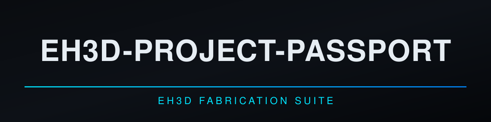
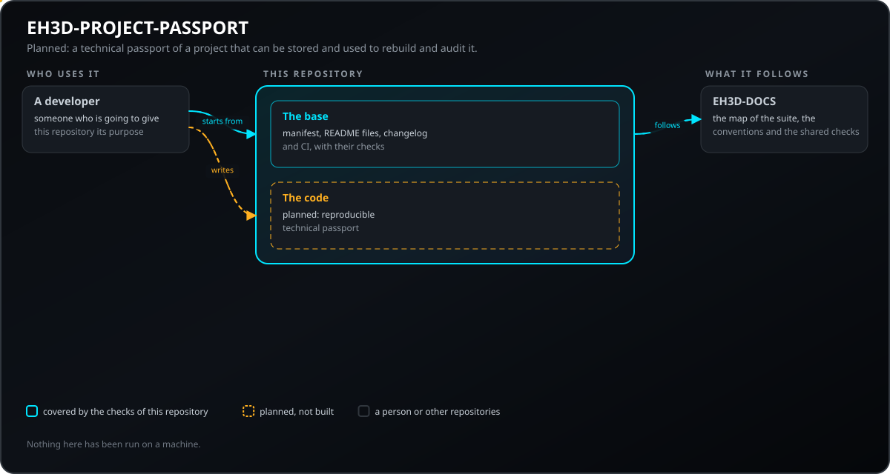
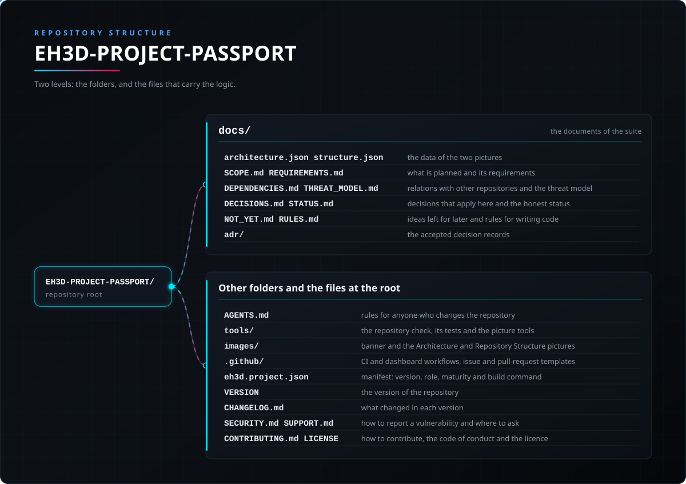

<p align="center">
  
</p>

# 🛠️ EH3D-PROJECT-PASSPORT

<p align="center"><a href="README.md">🇺🇸 English</a> | <a href="README_spa.md">🇪🇸 Español</a> | 🇫🇷 <b>Français</b> | <a href="README_ita.md">🇮🇹 Italiano</a> | <a href="README_deu.md">🇩🇪 Deutsch</a> | <a href="README_zho.md">🇨🇳 中文</a> | <a href="README_jpn.md">🇯🇵 日本語</a> | <a href="README_por.md">🇵🇹 Português</a></p>

### EH3D-PROJECT-PASSPORT : le passeport technique d'un projet : outils, fichiers d'entrée et de sortie avec leurs hashes, contrôles, limites et décisions en attente. Code initial.

<p align="center">
  
  
  
  
  
  
</p>

---

**Vérification d'honnêteté - ce qui tourne aujourd'hui :** une bibliothèque Rust et une ligne de commande qui lisent un passeport (un fichier JSON dont les sections sont toujours écrites, même vides), trouvent les hashes incorrects, chemins dangereux, doublons et outils sans version, affichent le SHA-256 de son contenu canonique, le comparent aux fichiers d'un dossier (seulement lu) pour trouver ceux qui manquent ou ont changé, comparent deux passeports et affichent les références de fichiers pour en écrire un. Tout n'a tourné que sur des données faites par ses propres tests. N'existent pas : le générateur qui construit un passeport depuis un projet et son historique, la signature et la reconstruction des fichiers de fabrication.

---

> **État de la sûreté et de la sécurité :** ce dépôt en est à ses premiers pas et n'est pas un système de sûreté. Rien de ce qui est écrit ici ne remplace les limites, les verrouillages et l'arrêt d'urgence de la machine et de son contrôleur.

## 📋 En un coup d'œil

| | |
|---|---|
| Version | `0.0.1` |
| Maturité | Échafaudage |
| Tests | 3 |
| Pile technique | Markdown, Python 3.10+ |
| Sur du matériel réel | Pas encore exécuté sur du matériel |

**Aller à  :** [Présentation](#-présentation) · [Architecture](#-architecture) · [Démarrage rapide](#-démarrage-rapide) · [Tests](#-tests) · [Structure du dépôt](#-structure-du-dépôt) · [Projets liés](#-projets-liés)

## 🚦 État du projet

Chaque ligne est une partie de ce dépôt et le feu dit où elle en est aujourd'hui. Elle est écrite d'après ce que le dépôt peut montrer (tests, compilations, exécutions), pas d'après ce qui est prévu.

🟢 Fait et vérifié · 🟡 Fonctionne, avec des limites connues · 🟠 À moitié fait ou pas encore vérifié · 🔴 Pas fait ou ne fonctionne pas

| Domaine | État | Ce que cela veut dire ici |
|---|---|---|
| Contrôles du dépôt | 🟡 | Le contrôle du dépôt, celui des images et les 3 tests de la base tournent dans la CI et réussissent. |
| Tests | 🟡 | Les 13 tests du code Rust et les 3 de la base réussissent sur un ordinateur. Ils n'utilisent que des données faites par les tests eux-mêmes. |
| Matériel réel | 🟠 | Non exécuté sur une machine ni une carte : rien ici n'a été essayé sur du matériel. |
| Fonction prévue | 🟠 | Écrit : les sections du passeport, les contrôles, le hash canonique, la comparaison avec les fichiers d'un dossier et entre deux passeports. Non écrit : le générateur depuis un projet, la reconstruction des fichiers de fabrication et la signature facultative. |
| Exigences | 🟠 | 5 des 6 exigences sont au stade de prototype ; la signature facultative (PPAS-005) est seulement prévue. Aucune n'est validée. |

## 🎯 Présentation

* **Ce qui existe :** une bibliothèque et une ligne de commande, sans fenêtre, qui contrôlent un passeport (`check`), le comparent à un dossier (`verify`), affichent son hash (`hash`), comparent deux passeports (`compare`) et calculent le hash de fichiers (`hashfiles`). **Prévu :** le générateur depuis un projet, la reconstruction des fichiers de fabrication, la signature facultative et un type de tâche du serveur.

## 🧩 Rôle dans EH3D

EH3D-PROJECT-PASSPORT fait partie de la famille PHOENIX de l'EH3D Fabrication Suite. Ce qu'il fera, ce qu'il ne fera pas encore, ses exigences et ses relations avec d'autres dépôts sont décrits dans le dossier `docs/`.

## 🏛️ Architecture

<p align="center">
  
</p>

Comment les parties de ce dépôt s'articulent : qui l'utilise, ce qu'il contient et de quoi il dépend. L'image est dessinée à partir de `docs/architecture.json` et vérifiée par rapport au code.

## 🚀 Démarrage rapide

Il faut Python 3.10 ou plus récent ; il n'y a rien à installer.

```bash
python -I tools/ci_validate.py
python -I tools/make_architecture.py --check
python -I tools/make_structure.py --check --readmes
python -I -m unittest discover -s tools -p "test_*.py"
```

## 🧪 Tests

La base a 3 tests (`python -I -m unittest discover -s tools -p "test_*.py"`), et ils réussissent. La CI exécute le contrôle du dépôt, celui des images et ces tests.

## 🏗️ Compilation et publication

La version se trouve dans le fichier `VERSION` et dans `eh3d.project.json`, et chaque version a son entrée dans [CHANGELOG.md](CHANGELOG.md). Il n'y a rien à compiler ; les versions sont publiées sur GitHub.

## 📂 Structure du dépôt

<p align="center">
  
</p>

<details>
<summary>Version texte de l'arborescence</summary>

```text
EH3D-PROJECT-PASSPORT/
├── docs/
│   ├── architecture.json structure.json         les données des deux images
│   ├── SCOPE.md REQUIREMENTS.md                 ce qui est prévu et ses exigences
│   ├── DEPENDENCIES.md THREAT_MODEL.md          relations avec d'autres dépôts et modèle de menaces
│   ├── DECISIONS.md STATUS.md                   décisions applicables ici et état honnête
│   ├── NOT_YET.md RULES.md                      idées pour plus tard et règles d'écriture du code
│   └── adr/                                     les décisions acceptées
├── AGENTS.md                                    règles pour quiconque modifie le dépôt
├── src/                                         la bibliothèque et la ligne de commande
├── Cargo.toml  deny.toml                        paquet Rust et politique des dépendances
├── tools/                                       le contrôle du dépôt, ses tests et les outils des images
├── images/                                      bannière et images d'Architecture et de Structure du dépôt
├── .github/                                     workflows de CI et du tableau de bord, modèles d'issues et de pull requests
├── eh3d.project.json                            manifeste : version, rôle, maturité et commande de compilation
├── VERSION                                      la version du dépôt
├── CHANGELOG.md                                 ce qui a changé dans chaque version
├── SECURITY.md SUPPORT.md                       signaler une vulnérabilité et poser des questions
└── CONTRIBUTING.md CODE_OF_CONDUCT.md LICENSE   contribuer, code de conduite et licence
```

</details>

## 🗺️ Feuille de route et limites connues

**Limites connues aujourd'hui**

* Code initial : n'a tourné que sur des données de ses propres tests ; il ne construit pas de passeport depuis un projet et ne signe pas.

**Ensuite**

* Attendre l'acceptation des contrats dont dépend ce projet (voir `docs/DEPENDENCIES.md`), puis écrire la première version avec des tests et remplacer les lignes d'état par des résultats réels.

## 🌍 Langues

Le README et les textes existent en anglais, espagnol, français, italien, allemand, chinois, japonais et portugais européen.

## 🔗 Projets liés

* [EH3D-DOCS](https://github.com/JuanenRac/EH3D-DOCS) : la carte de la suite, son architecture, les conventions et les contrôles partagés
* Relations prévues, pas encore construites (EH3D-COMMON, EH3D-DESIGN-HISTORY, EH3D-PHOENIX-PCB, EH3D-DESIGN-VERIFIER, EH3D-MANUFACTURING-PROFILE, EH3D-COMPONENT-INTELLIGENCE, EH3D-LAB-BRIDGE) : voir [docs/DEPENDENCIES.md](docs/DEPENDENCIES.md)

## 📚 Documentation

* [Les conventions de la suite](https://github.com/JuanenRac/EH3D-DOCS/blob/main/docs/CONVENTIONS.md)
* [Journal des modifications](CHANGELOG.md)
* [Périmètre, exigences, dépendances, modèle de menaces et décisions](docs/SCOPE.md)

## 🤝 Contribuer et communauté

* Avant une pull request, exécutez `python -I tools/ci_validate.py` et les tests de la base : tout doit réussir. Voir [CONTRIBUTING.md](CONTRIBUTING.md) et le [code de conduite](CODE_OF_CONDUCT.md).
* Le README existe en huit langues : une modification du texte se fait dans les huit fichiers, et les deux images sont dessinées à partir de `docs/architecture.json` et `docs/structure.json` par `tools/make_architecture.py` et `tools/make_structure.py`.
* Signalez une vulnérabilité en privé : [SECURITY.md](SECURITY.md). Questions, idées et rapports : electrohobby3d@gmail.com ([SUPPORT.md](SUPPORT.md)).

## 👤 AUTEUR

**JuanenRac (Electro Hobby 3D)** · electrohobby3d@gmail.com

## 📜 LICENCE

Logiciel : GPL-3.0-or-later. Voir [LICENSE](LICENSE). Les conceptions matérielles de la suite utilisent la CERN OHL-S.
