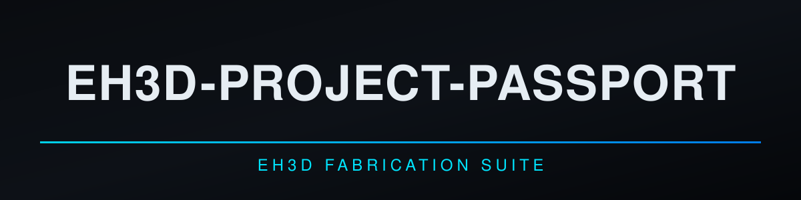
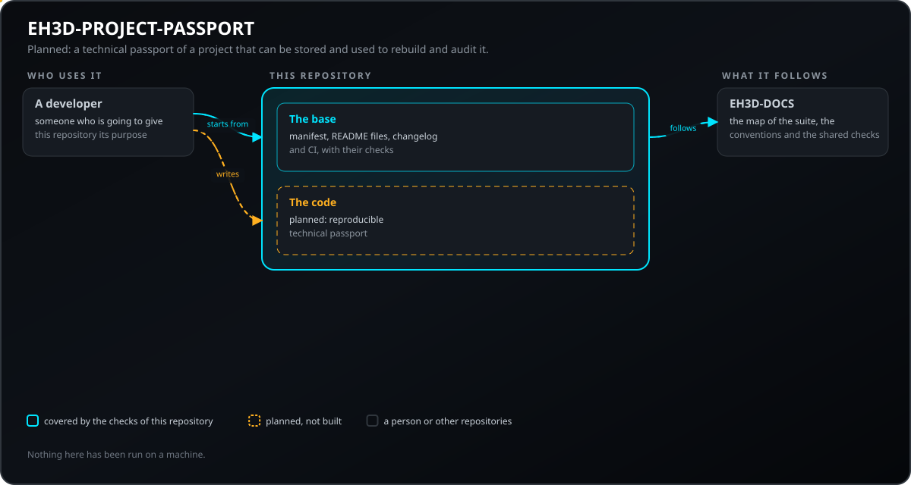
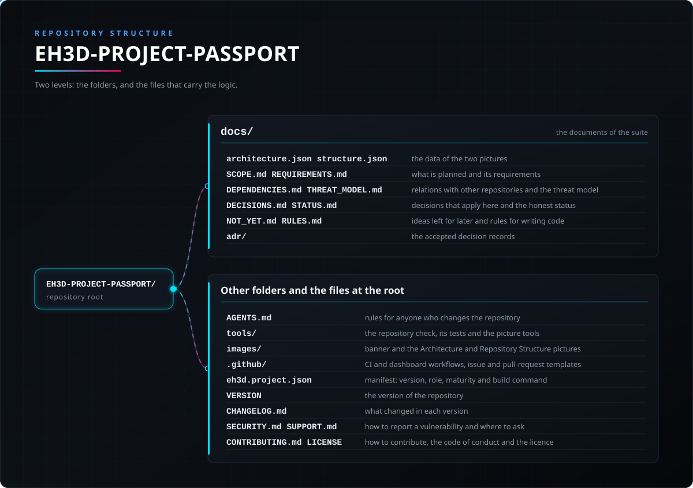

<p align="center">
  
</p>

#  EH3D-PROJECT-PASSPORT

<p align="center"><a href="README.md">🇺🇸 English</a> | <a href="README_spa.md">🇪🇸 Español</a> | <a href="README_fra.md">🇫🇷 Français</a> | 🇮🇹 <b>Italiano</b> | <a href="README_deu.md">🇩🇪 Deutsch</a> | <a href="README_zho.md">🇨🇳 中文</a> | <a href="README_jpn.md">🇯🇵 日本語</a> | <a href="README_por.md">🇵🇹 Português</a></p>

### EH3D-PROJECT-PASSPORT: il passaporto tecnico di un progetto: strumenti, file di ingresso e di uscita con i loro hash, controlli, limiti e decisioni in sospeso. Codice iniziale.

<p align="center">
  
  
  
  
  
  
</p>

---

**Verifica di onestà - cosa funziona oggi:** una libreria Rust e una riga di comando che leggono un passaporto (un file JSON le cui sezioni sono sempre scritte, anche se vuote), trovano hash errati, percorsi non sicuri, duplicati e strumenti senza versione, stampano lo SHA-256 del suo contenuto canonico, lo confrontano con i file di una cartella (solo letta) per trovare quelli mancanti o cambiati, confrontano due passaporti e stampano i riferimenti dei file per scriverne uno. Tutto è stato eseguito solo su dati prodotti dai propri test. Non esistono: il generatore che costruisce un passaporto da un progetto e dalla sua cronologia, la firma e la ricostruzione dei file di produzione.

---

> **Stato di sicurezza funzionale e informatica:** questo repository è ai primi passi e non è un sistema di sicurezza funzionale. Nulla di quanto scritto qui sostituisce i limiti, gli interblocchi e l'arresto di emergenza della macchina e del suo controllore.

## 📋 In breve

| | |
|---|---|
| Versione | `0.0.1` |
| Maturità | Impalcatura |
| Test | 3 |
| Stack tecnologico | Markdown, Python 3.10+ |
| Su hardware reale | Non ancora eseguito su hardware |

**Vai a:** [Panoramica](#-panoramica) · [Architettura](#-architettura) · [Avvio rapido](#-avvio-rapido) · [Test](#-test) · [Struttura del repository](#-struttura-del-repository) · [Progetti correlati](#-progetti-correlati)

## 🚦 Stato del progetto

Ogni riga è una parte di questo repository e il semaforo dice a che punto è oggi. È scritta in base a ciò che il repository può mostrare (test, compilazioni, esecuzioni), non a ciò che è previsto.

🟢 Fatto e verificato · 🟡 Funziona, con limiti noti · 🟠 Fatto a metà o non ancora verificato · 🔴 Non fatto o non funzionante

| Area | Stato | Cosa significa qui |
|---|---|---|
| Controlli del repository | 🟡 | Il controllo del repository, quello delle immagini e i 3 test della base girano nella CI e passano. |
| Test | 🟡 | I 13 test del codice Rust e i 3 della base passano su un computer. Usano solo dati prodotti dai test stessi. |
| Hardware reale | 🟠 | Non eseguito su nessuna macchina né scheda: nulla qui è stato provato su hardware. |
| Funzione pianificata | 🟠 | Scritto: le sezioni del passaporto, i controlli, l'hash canonico, il confronto con i file di una cartella e tra due passaporti. Non scritto: il generatore da un progetto, la ricostruzione dei file di produzione e la firma facoltativa. |
| Requisiti | 🟠 | 5 dei 6 requisiti sono a livello di prototipo; la firma facoltativa (PPAS-005) è solo pianificata. Nessuno è validato. |

## 🎯 Panoramica

* **Cosa esiste:** una libreria e una riga di comando, senza finestra, che controllano un passaporto (`check`), lo confrontano con una cartella (`verify`), ne stampano l'hash (`hash`), confrontano due passaporti (`compare`) e calcolano l'hash di file (`hashfiles`). **Pianificato:** il generatore da un progetto, la ricostruzione dei file di produzione, la firma facoltativa e un tipo di attività del server.

## 🧩 Ruolo in EH3D

EH3D-PROJECT-PASSPORT fa parte della famiglia PHOENIX della EH3D Fabrication Suite. Cosa farà, cosa non farà ancora, i suoi requisiti e le sue relazioni con altri repository sono scritti nella cartella `docs/`.

## 🏛️ Architettura

<p align="center">
  
</p>

Come si incastrano le parti di questo repository: chi lo usa, che cosa contiene e da che cosa dipende. L'immagine è disegnata da `docs/architecture.json` e verificata rispetto al codice.

## 🚀 Avvio rapido

Serve Python 3.10 o successivo; non c'è nulla da installare.

```bash
python -I tools/ci_validate.py
python -I tools/make_architecture.py --check
python -I tools/make_structure.py --check --readmes
python -I -m unittest discover -s tools -p "test_*.py"
```

## 🧪 Test

La base ha 3 test (`python -I -m unittest discover -s tools -p "test_*.py"`), e passano. La CI esegue il controllo del repository, quello delle immagini e questi test.

## 🏗️ Compilazione e rilascio

La versione sta nel file `VERSION` e in `eh3d.project.json`, e ogni versione ha la sua voce in [CHANGELOG.md](CHANGELOG.md). Non c'è nulla da compilare; le versioni vengono pubblicate su GitHub.

## 📂 Struttura del repository

<p align="center">
  
</p>

<details>
<summary>Versione testuale dell'albero</summary>

```text
EH3D-PROJECT-PASSPORT/
├── docs/
│   ├── architecture.json structure.json         i dati delle due immagini
│   ├── SCOPE.md REQUIREMENTS.md                 ciò che è pianificato e i suoi requisiti
│   ├── DEPENDENCIES.md THREAT_MODEL.md          relazioni con altri repository e modello delle minacce
│   ├── DECISIONS.md STATUS.md                   decisioni applicabili qui e stato onesto
│   ├── NOT_YET.md RULES.md                      idee per dopo e regole per scrivere il codice
│   └── adr/                                     i registri delle decisioni accettate
├── AGENTS.md                                    regole per chi modifica il repository
├── src/                                         la libreria e la riga di comando
├── Cargo.toml Cargo.lock deny.toml              pacchetto Rust e politica delle dipendenze
├── tools/                                       il controllo del repository, i suoi test e gli strumenti delle immagini
├── images/                                      banner e le immagini di Architettura e Struttura del repository
├── .github/                                     workflow di CI e della dashboard, modelli di issue e pull request
├── eh3d.project.json                            manifesto: versione, ruolo, maturità e comando di compilazione
├── VERSION                                      la versione del repository
├── CHANGELOG.md                                 cosa è cambiato in ogni versione
├── SECURITY.md SUPPORT.md                       come segnalare una vulnerabilità e dove chiedere
└── CONTRIBUTING.md CODE_OF_CONDUCT.md LICENSE   come contribuire, codice di condotta e licenza
```

</details>

## 🗺️ Roadmap e limiti noti

**Limiti noti oggi**

* Codice iniziale: eseguito solo su dati dei propri test; non costruisce un passaporto da un progetto e non firma.

**Prossimi passi**

* Attendere che i contratti da cui dipende questo progetto siano accettati (vedi `docs/DEPENDENCIES.md`), poi scrivere la prima versione con test e sostituire le righe di stato con risultati reali.

## 🌍 Lingue

Il README e i testi esistono in inglese, spagnolo, francese, italiano, tedesco, cinese, giapponese e portoghese europeo.

## 🔗 Progetti correlati

* [EH3D-DOCS](https://github.com/JuanenRac/EH3D-DOCS): la mappa della suite, la sua architettura, le convenzioni e i controlli condivisi
* Relazioni pianificate, non ancora costruite (EH3D-COMMON, EH3D-DESIGN-HISTORY, EH3D-PHOENIX-PCB, EH3D-DESIGN-VERIFIER, EH3D-MANUFACTURING-PROFILE, EH3D-COMPONENT-INTELLIGENCE, EH3D-LAB-BRIDGE): vedi [docs/DEPENDENCIES.md](docs/DEPENDENCIES.md)

## 📚 Documentazione

* [Le convenzioni della suite](https://github.com/JuanenRac/EH3D-DOCS/blob/main/docs/CONVENTIONS.md)
* [Registro delle modifiche](CHANGELOG.md)
* [Ambito, requisiti, dipendenze, modello delle minacce e decisioni](docs/SCOPE.md)

## 🤝 Contribuire e comunità

* Prima di una pull request esegui `python -I tools/ci_validate.py` e i test della base: tutto deve passare. Vedi [CONTRIBUTING.md](CONTRIBUTING.md) e il [codice di condotta](CODE_OF_CONDUCT.md).
* Il README esiste in otto lingue: una modifica al testo si fa in tutti e otto i file, e le due immagini sono disegnate da `docs/architecture.json` e `docs/structure.json` con `tools/make_architecture.py` e `tools/make_structure.py`.
* Segnala una vulnerabilità in privato: [SECURITY.md](SECURITY.md). Domande, idee e segnalazioni: electrohobby3d@gmail.com ([SUPPORT.md](SUPPORT.md)).

## 👤 AUTORE

**JuanenRac (Electro Hobby 3D)** · electrohobby3d@gmail.com

## 📜 LICENZA

Software: GPL-3.0-or-later. Vedi [LICENSE](LICENSE). I progetti hardware della suite usano la CERN OHL-S.
