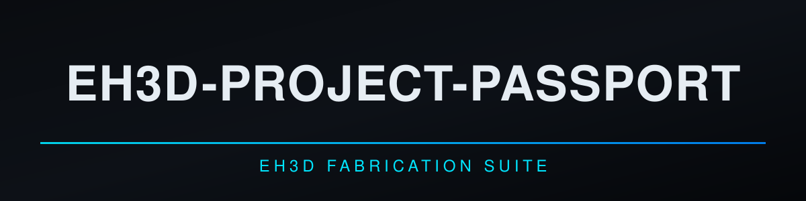
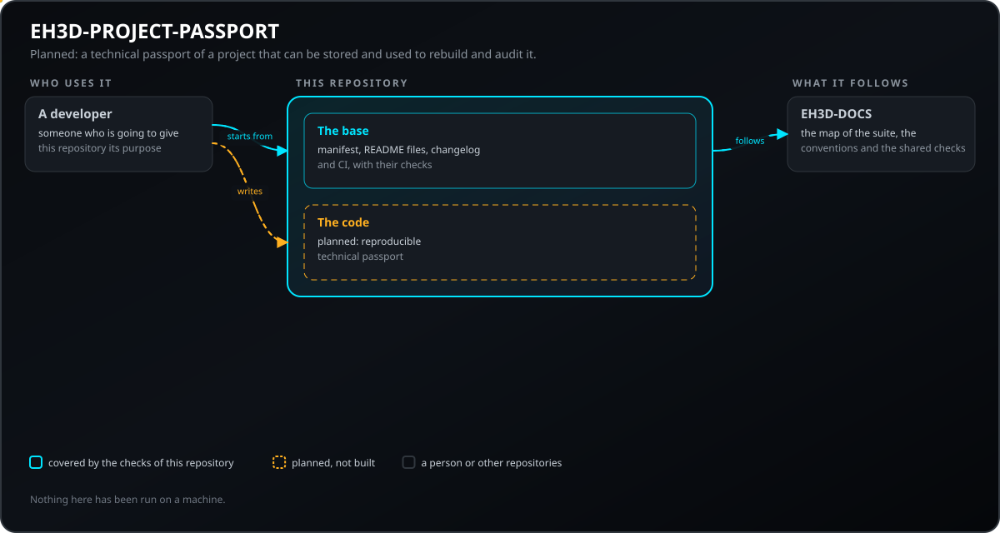
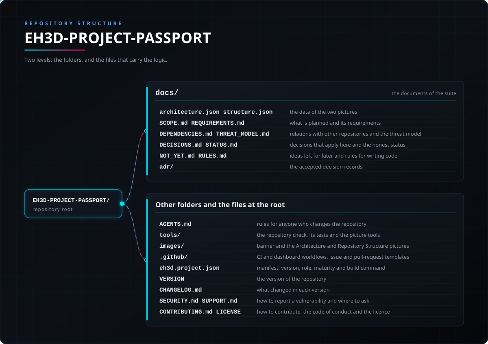

<p align="center">
  
</p>

#  EH3D-PROJECT-PASSPORT

<p align="center"><a href="README.md">🇺🇸 English</a> | <a href="README_spa.md">🇪🇸 Español</a> | <a href="README_fra.md">🇫🇷 Français</a> | <a href="README_ita.md">🇮🇹 Italiano</a> | <a href="README_deu.md">🇩🇪 Deutsch</a> | <a href="README_zho.md">🇨🇳 中文</a> | <a href="README_jpn.md">🇯🇵 日本語</a> | 🇵🇹 <b>Português</b></p>

### EH3D-PROJECT-PASSPORT: o passaporte técnico de um projeto: ferramentas, ficheiros de entrada e de saída com os seus hashes, verificações, limitações e decisões pendentes. Código inicial.

<p align="center">
  
  
  
  
  
  
</p>

---

**Verificação de honestidade - o que corre hoje:** uma biblioteca Rust e uma linha de comandos que leem um passaporte (um ficheiro JSON cujas secções são sempre escritas, mesmo vazias), encontram hashes incorretos, caminhos inseguros, duplicados e ferramentas sem versão, mostram o SHA-256 do seu conteúdo canónico, comparam-no com os ficheiros de uma pasta (que só é lida) para achar os que faltam ou mudaram, comparam dois passaportes e mostram as referências de ficheiros para escrever um. Tudo correu apenas com dados feitos pelos próprios testes. O que não existe: o gerador que constrói um passaporte a partir de um projeto e do seu histórico, a assinatura e a reconstrução dos ficheiros de fabrico.

---

> **Estado de segurança (safety) e de segurança informática:** este repositório está nos primeiros passos e não é um sistema de segurança (safety). Nada do que está escrito aqui substitui os limites, os bloqueios e a paragem de emergência da máquina e do seu controlador.

## 📋 Num relance

| | |
|---|---|
| Versão | `0.0.2` |
| Maturidade | Estrutura inicial |
| Testes | 3 |
| Tecnologias | Markdown, Python 3.10+ |
| Em hardware real | Ainda não executado em hardware |

**Ir para:** [Visão geral](#-visão-geral) · [Arquitetura](#-arquitetura) · [Início rápido](#-início-rápido) · [Testes](#-testes) · [Estrutura do repositório](#-estrutura-do-repositório) · [Projetos relacionados](#-projetos-relacionados)

## 🚦 Estado do projeto

Cada linha é uma parte deste repositório e a luz diz até onde chega hoje. É escrita com o que o repositório consegue demonstrar (testes, compilações, execuções), não com o que está previsto.

🟢 Feito e verificado · 🟡 Funciona, com limites conhecidos · 🟠 Feito a meio ou ainda por verificar · 🔴 Por fazer ou a não funcionar

| Área | Estado | O que significa aqui |
|---|---|---|
| Verificações do repositório | 🟡 | A verificação do repositório, a das imagens e os 3 testes da base correm na CI e passam. |
| Testes | 🟡 | Os 13 testes do código Rust e os 3 da base passam num computador. Usam apenas dados feitos pelos próprios testes. |
| Hardware real | 🟠 | Não foi executado em nenhuma máquina nem placa: nada aqui foi experimentado em hardware. |
| Função planeada | 🟠 | Escrito: as secções do passaporte, as verificações, o hash canónico, a comparação com os ficheiros de uma pasta e entre dois passaportes. Por escrever: o gerador a partir de um projeto, a reconstrução dos ficheiros de fabrico e a assinatura opcional. |
| Requisitos | 🟠 | 5 dos 6 requisitos estão em protótipo; a assinatura opcional (PPAS-005) está apenas planeada. Nenhum está validado. |

## 🎯 Visão geral

* **O que existe:** uma biblioteca e uma linha de comandos, sem janela, que verificam um passaporte (`check`), comparam-no com uma pasta (`verify`), mostram o seu hash (`hash`), comparam dois passaportes (`compare`) e calculam o hash de ficheiros (`hashfiles`). **Planeado:** o gerador a partir de um projeto, a reconstrução dos ficheiros de fabrico, a assinatura opcional e um tipo de tarefa do servidor.

## 🧩 Papel no EH3D

EH3D-PROJECT-PASSPORT faz parte da família PHOENIX da EH3D Fabrication Suite. O que fará, o que ainda não fará, os seus requisitos e as suas relações com outros repositórios estão escritos na pasta `docs/`.

## 🏛️ Arquitetura

<p align="center">
  
</p>

Como as partes deste repositório se encaixam: quem o usa, o que contém e de que depende. A imagem é desenhada a partir de `docs/architecture.json` e verificada com o código.

## 🚀 Início rápido

Precisa de Python 3.10 ou mais recente; não há nada a instalar.

```bash
python -I tools/ci_validate.py
python -I tools/make_architecture.py --check
python -I tools/make_structure.py --check --readmes
python -I -m unittest discover -s tools -p "test_*.py"
```

## 🧪 Testes

A base tem 3 testes (`python -I -m unittest discover -s tools -p "test_*.py"`), e passam. A CI executa a verificação do repositório, a das imagens e esses testes.

## 🏗️ Compilação e publicação

A versão vive no ficheiro `VERSION` e em `eh3d.project.json`, e cada versão tem a sua entrada em [CHANGELOG.md](CHANGELOG.md). Não há nada a compilar; as versões são publicadas no GitHub.

## 📂 Estrutura do repositório

<p align="center">
  
</p>

<details>
<summary>Versão em texto da árvore</summary>

```text
EH3D-PROJECT-PASSPORT/
├── docs/
│   ├── architecture.json structure.json         os dados das duas imagens
│   ├── SCOPE.md REQUIREMENTS.md                 o que está planeado e os seus requisitos
│   ├── DEPENDENCIES.md THREAT_MODEL.md          relações com outros repositórios e modelo de ameaças
│   ├── DECISIONS.md STATUS.md                   decisões que se aplicam aqui e estado honesto
│   ├── NOT_YET.md RULES.md                      ideias para mais tarde e regras para escrever código
│   └── adr/                                     os registos das decisões aceites
├── AGENTS.md                                    regras para quem altera o repositório
├── src/                                         a biblioteca e a linha de comandos
├── Cargo.toml Cargo.lock deny.toml              pacote Rust e política das dependências
├── rust-toolchain.toml                          a toolchain de Rust fixada
├── tools/                                       a verificação do repositório, os seus testes e as ferramentas das imagens
├── images/                                      banner e as imagens de Arquitetura e Estrutura do repositório
├── .github/                                     fluxos de CI e do painel, modelos de issues e pull requests
├── eh3d.project.json                            manifesto: versão, papel, maturidade e comando de compilação
├── VERSION                                      a versão do repositório
├── CHANGELOG.md                                 o que mudou em cada versão
├── SECURITY.md SUPPORT.md                       como comunicar uma vulnerabilidade e onde perguntar
└── CONTRIBUTING.md CODE_OF_CONDUCT.md LICENSE   como contribuir, o código de conduta e a licença
```

</details>

## 🗺️ Roteiro e limites conhecidos

**Limites conhecidos hoje**

* Código inicial: só correu com dados dos próprios testes; não constrói um passaporte a partir de um projeto nem assina.

**A seguir**

* Esperar que os contratos de que este projeto depende sejam aceites (ver `docs/DEPENDENCIES.md`), escrever depois a primeira versão com testes e substituir as linhas de estado por resultados reais.

## 🌍 Idiomas

O README e os textos existem em inglês, espanhol, francês, italiano, alemão, chinês, japonês e português europeu.

## 🔗 Projetos relacionados

* [EH3D-DOCS](https://github.com/JuanenRac/EH3D-DOCS): o mapa da suite, a sua arquitetura, as convenções e as verificações partilhadas
* Relações planeadas, ainda por construir (EH3D-COMMON, EH3D-DESIGN-HISTORY, EH3D-PHOENIX-PCB, EH3D-DESIGN-VERIFIER, EH3D-MANUFACTURING-PROFILE, EH3D-COMPONENT-INTELLIGENCE, EH3D-LAB-BRIDGE): ver [docs/DEPENDENCIES.md](docs/DEPENDENCIES.md)

## 📚 Documentação

* [As convenções da suite](https://github.com/JuanenRac/EH3D-DOCS/blob/main/docs/CONVENTIONS.md)
* [Registo de alterações](CHANGELOG.md)
* [Âmbito, requisitos, dependências, modelo de ameaças e decisões](docs/SCOPE.md)

## 🤝 Contribuir e comunidade

* Antes de um pull request, execute `python -I tools/ci_validate.py` e os testes da base: tudo tem de passar. Consulte [CONTRIBUTING.md](CONTRIBUTING.md) e o [código de conduta](CODE_OF_CONDUCT.md).
* O README existe em oito idiomas: uma alteração ao texto faz-se nos oito ficheiros, e as duas imagens são desenhadas a partir de `docs/architecture.json` e `docs/structure.json` com `tools/make_architecture.py` e `tools/make_structure.py`.
* Comunique uma vulnerabilidade em privado: [SECURITY.md](SECURITY.md). Perguntas, ideias e relatórios: electrohobby3d@gmail.com ([SUPPORT.md](SUPPORT.md)).

## 👤 AUTOR

**JuanenRac (Electro Hobby 3D)** · electrohobby3d@gmail.com

## 📜 LICENÇA

Software: GPL-3.0-or-later. Ver [LICENSE](LICENSE). Os projetos de hardware da suite usam a CERN OHL-S.
