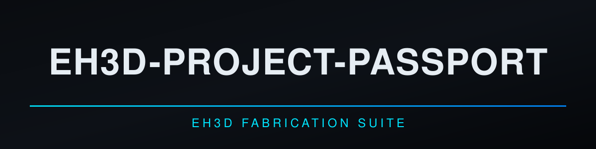
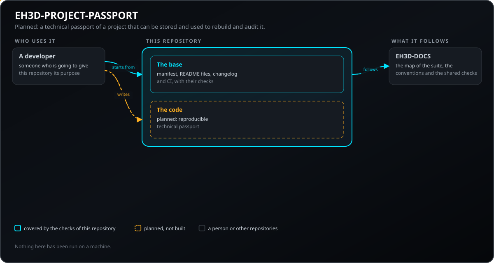
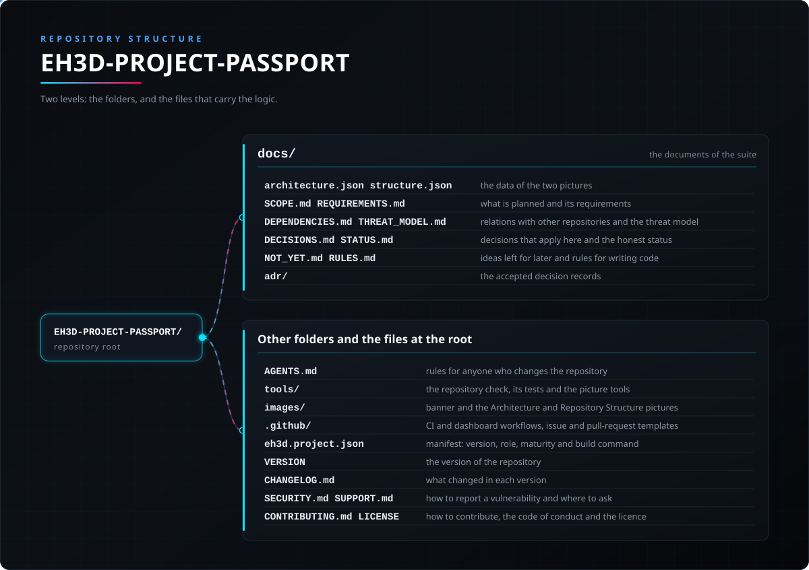

<p align="center">
  
</p>

#  EH3D-PROJECT-PASSPORT

<p align="center"><a href="README.md">🇺🇸 English</a> | <a href="README_spa.md">🇪🇸 Español</a> | <a href="README_fra.md">🇫🇷 Français</a> | <a href="README_ita.md">🇮🇹 Italiano</a> | <a href="README_deu.md">🇩🇪 Deutsch</a> | 🇨🇳 <b>中文</b> | <a href="README_jpn.md">🇯🇵 日本語</a> | <a href="README_por.md">🇵🇹 Português</a></p>

### EH3D-PROJECT-PASSPORT：项目的技术护照：工具、带哈希的输入输出文件、检查、限制和待定决策。早期代码。

<p align="center">
  
  
  
  
  
  
</p>

---

**诚实性核对 - 今天真正能运行的内容：** 一个 Rust 库和一个命令行，读取护照（各部分始终写出的 JSON 文件，即使为空），找出错误的哈希、不安全的路径、重复项和没有版本的工具，输出其规范化内容的 SHA-256，把它与文件夹（只读）中的文件比较以找出缺失或已更改的文件，比较两份护照，并输出用于编写护照的文件引用。所有这些只用自身测试生成的数据运行过。尚不存在：从项目及其历史生成护照的生成器、签名，以及制造文件的重建。

---

> **安全（safety）与信息安全现状：** 本仓库刚刚起步，不是安全系统（safety）。这里写的任何内容都不能取代机床及其控制器的限位、联锁和急停。

## 📋 速览

| | |
|---|---|
| 版本 | `0.0.2` |
| 成熟度 | 脚手架 |
| 测试 | 3 |
| 技术栈 | Markdown, Python 3.10+ |
| 真实硬件 | 尚未在硬件上运行 |

**跳转到：** [概述](#-概述) · [架构](#-架构) · [快速开始](#-快速开始) · [测试](#-测试) · [仓库结构](#-仓库结构) · [相关项目](#-相关项目)

## 🚦 项目状态

每一行是本仓库的一个部分，灯号表示它今天做到了哪一步。内容依据仓库能够展示的证据（测试、构建、运行），而不是计划。

🟢 已完成并验证 · 🟡 可用，有已知限制 · 🟠 部分完成或尚未验证 · 🔴 未完成或不可用

| 领域 | 状态 | 在这里的含义 |
|---|---|---|
| 仓库检查 | 🟡 | 仓库检查、图片检查以及基础部分的 3 个测试都在 CI 中运行并通过。 |
| 测试 | 🟡 | Rust 代码的 13 个测试和基础部分的 3 个测试在计算机上通过。它们只使用测试自己生成的数据。 |
| 真实硬件 | 🟠 | 没有在任何机床或电路板上运行过：这里没有任何内容在硬件上试过。 |
| 计划的功能 | 🟠 | 已编写：护照的各个部分、检查、规范化哈希、与文件夹文件的比较以及两份护照之间的比较。未编写：从项目生成、制造文件的重建和可选签名。 |
| 需求 | 🟠 | 6 项需求中有 5 项处于原型阶段；可选签名（PPAS-005）仅在计划中。没有一项已验证。 |

## 🎯 概述

* **已有内容：** 一个无窗口的库和命令行，检查护照（`check`）、与文件夹比较（`verify`）、输出其哈希（`hash`）、比较两份护照（`compare`）并计算文件哈希（`hashfiles`）。**计划中：** 从项目生成、制造文件的重建、可选签名，以及一种服务器任务。

## 🧩 在 EH3D 中的角色

EH3D-PROJECT-PASSPORT 是 EH3D Fabrication Suite 的 PHOENIX 系列的一部分。它将做什么、暂时不做什么、需求以及与其他仓库的关系都写在 `docs/` 文件夹中。

## 🏛️ 架构

<p align="center">
  
</p>

本仓库各部分如何协作：谁在使用它、它包含什么、它依赖什么。图片由 `docs/architecture.json` 绘制，并与代码核对。

## 🚀 快速开始

需要 Python 3.10 或更高版本；无需安装任何东西。

```bash
python -I tools/ci_validate.py
python -I tools/make_architecture.py --check
python -I tools/make_structure.py --check --readmes
python -I -m unittest discover -s tools -p "test_*.py"
```

## 🧪 测试

基础部分有 3 个测试（`python -I -m unittest discover -s tools -p "test_*.py"`），并且都通过。CI 运行仓库检查、图片检查和这些测试。

## 🏗️ 构建与发布

版本号位于 `VERSION` 文件和 `eh3d.project.json`，每个版本在 [CHANGELOG.md](CHANGELOG.md) 中都有条目。没有需要构建的东西；版本发布在 GitHub 上。

## 📂 仓库结构

<p align="center">
  
</p>

<details>
<summary>目录树的文本版</summary>

```text
EH3D-PROJECT-PASSPORT/
├── docs/
│   ├── architecture.json structure.json         两张图的数据
│   ├── SCOPE.md REQUIREMENTS.md                 计划内容及其需求
│   ├── DEPENDENCIES.md THREAT_MODEL.md          与其他仓库的关系和威胁模型
│   ├── DECISIONS.md STATUS.md                   适用的决策和如实的状态
│   ├── NOT_YET.md RULES.md                      留待以后的想法和编写代码的规则
│   └── adr/                                     已接受的决策记录
├── AGENTS.md                                    修改仓库的人需遵守的规则
├── src/                                         库和命令行
├── Cargo.toml Cargo.lock deny.toml              Rust 包与依赖策略
├── rust-toolchain.toml                          固定的 Rust 工具链
├── tools/                                       仓库检查、其测试以及图片工具
├── images/                                      横幅图以及架构和仓库结构图片
├── .github/                                     CI 与仪表板工作流、Issue 和 PR 模板
├── eh3d.project.json                            清单：版本、角色、成熟度和构建命令
├── VERSION                                      仓库的版本
├── CHANGELOG.md                                 每个版本的变更
├── SECURITY.md SUPPORT.md                       如何报告漏洞及在哪里提问
└── CONTRIBUTING.md CODE_OF_CONDUCT.md LICENSE   参与贡献、行为准则和许可证
```

</details>

## 🗺️ 路线图与已知限制

**目前已知的限制**

* 早期代码：只用自身测试的数据运行过；它不会从项目生成护照，也不会签名。

**下一步**

* 等待本项目所依赖的契约被接受（见 `docs/DEPENDENCIES.md`），然后编写带测试的第一个版本，并用真实结果替换状态行。

## 🌍 语言

README 和文本提供英语、西班牙语、法语、意大利语、德语、汉语、日语和欧洲葡萄牙语版本。

## 🔗 相关项目

* [EH3D-DOCS](https://github.com/JuanenRac/EH3D-DOCS)：套件地图、架构、约定和共享检查
* 计划中的关系，尚未构建（EH3D-COMMON, EH3D-DESIGN-HISTORY, EH3D-PHOENIX-PCB, EH3D-DESIGN-VERIFIER, EH3D-MANUFACTURING-PROFILE, EH3D-COMPONENT-INTELLIGENCE, EH3D-LAB-BRIDGE）：见 [docs/DEPENDENCIES.md](docs/DEPENDENCIES.md)

## 📚 文档

* [套件的约定](https://github.com/JuanenRac/EH3D-DOCS/blob/main/docs/CONVENTIONS.md)
* [变更日志](CHANGELOG.md)
* [范围、需求、依赖、威胁模型和决策](docs/SCOPE.md)

## 🤝 参与贡献与社区

* 提交 pull request 之前运行 `python -I tools/ci_validate.py` 和基础部分的测试：必须全部通过。见 [CONTRIBUTING.md](CONTRIBUTING.md) 和[行为准则](CODE_OF_CONDUCT.md)。
* README 有八种语言：修改文字时要同步修改全部八个文件，两张图片由 `tools/make_architecture.py` 和 `tools/make_structure.py` 根据 `docs/architecture.json` 和 `docs/structure.json` 绘制。
* 请私下报告漏洞：[SECURITY.md](SECURITY.md)。问题、想法和报告：electrohobby3d@gmail.com（[SUPPORT.md](SUPPORT.md)）。

## 👤 作者

**JuanenRac (Electro Hobby 3D)** · electrohobby3d@gmail.com

## 📜 许可证

软件：GPL-3.0-or-later。见 [LICENSE](LICENSE)。套件的硬件设计使用 CERN OHL-S。
